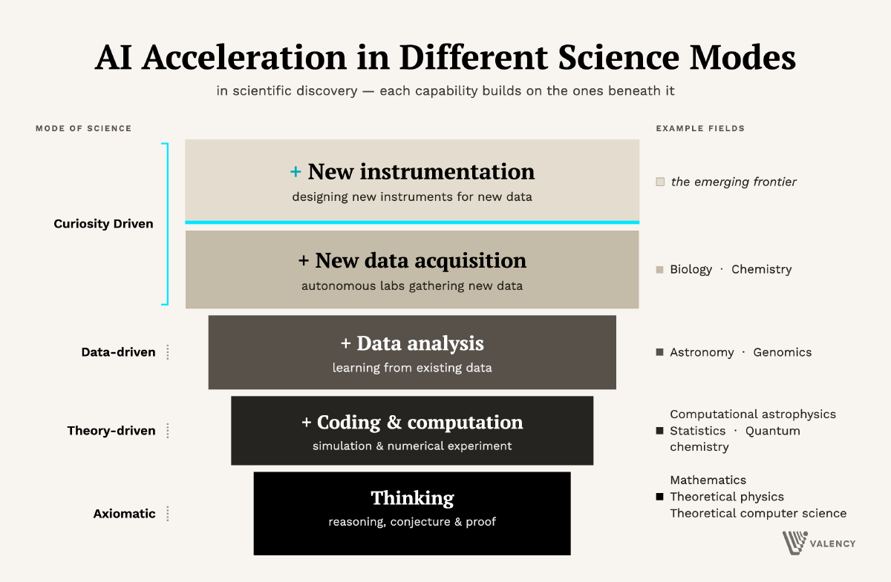

*This post originally appeared on [the Valency Blog](https://blog.valency.io/posts/navier-stokes-ai-science/).*

As the news breaks[^1][^2] of a partial solution to the famous Navier-Stokes equations, one of the major heretofore unsolved problems in mathematics[^3], it’s worth taking stock of where (and how) this result lands for the promise of AI acceleration in science. While an exciting major milestone in mathematics and a triumph of frontier model capabilities[^4], I think this work marks just the beginning of the beginning of the acceleration of AI more broadly in science. Let me explain.

The [Navier-Stokes equations](https://en.wikipedia.org/wiki/Navier%E2%80%93Stokes_equations) describe how a fluid’s velocity evolves under its own inertia, pressure, and viscosity, and the Clay Millennium Prize asks whether smooth 3D solutions always exist for all time or can break down in finite time[^3]. The problem statement allows either a proof of global regularity (options A/B) or a demonstration of finite-time blow-up with smooth external forcing (options C/D)[^3].

While a pure mathematical construct, NS in its most generic form captures many of the properties of real physical systems, based on simple real-world “axioms” like conservation of matter and conservation of momentum. As such, a wide group of physical scientists look to NS as a mathematical description of our scenarios: aerodynamicists studying airflow over wings, us astronomers studying the flow of ejecta from a supernova into the interstellar medium, climate scientists modeling the atmosphere and oceans, and biomedical engineers modeling blood flow through arteries. The unknown answer until today was whether fluid flow, regardless of initial conditions, would always be smooth or would lead to a blow-up “singularity” (not in the AI sense but in the physical sense, with increasingly more energy concentrated in ever smaller scales), where energy from large scales could get transferred to smaller and smaller scales without getting dissipated by the viscosity (or pressure) of the fluid. Understanding NS would help us understand turbulence.

Now it seems that there are indeed conditions where singularities can arise — proven, with Lean-checked proofs, for the inviscid Euler equations and two simpler model equations[^5], and, OpenAI claims, for Navier-Stokes itself[^1] — but those are contrived, driven by an external driving force that is particularly tuned to the initial conditions and properties of the fluid. This is the “C/D” scenario of NS, and it certainly portends the possibility that such conditions could exist without a driving force (and that viscosity does not always save the day)[^6]. Indeed, that possibility is now partly realized one rung down the ladder: as a stepping stone to the forced NS result, OpenAI’s agents also claim a finite-time singularity for the *unforced* Euler equations — no external force at all, with viscosity set to zero — again with a writeup and a Lean formalization[^7].

So where does this land in the AI-accelerated science landscape? First, the “C/D” scenario of NS is not physically plausible. While it may one day be set up in a lab to confirm it, highly tuned driving forces do not generally exist in nature. Second, and perhaps more fundamentally, NS was never a complete description of physical systems. On small scales, fluids do not behave according to the NS equations; instead, finite particle sizes become important (e.g., the mean free path of air molecules at sea level is about 68 nm[^8], below which there is no continuum to describe), so mathematically existent blow-up singularities may happen in regimes where the equations aren’t valid.

The frontier LLMs are clearly getting very good at the “Thinking” fields, where axioms can be posited, reasoned over, proven, and used to construct ever more complex edifices on 100% solid ground (thanks to rigorous languages like Lean 4). Examples of this working well have abounded over the past few months, even before today’s news: Claude agents produced the first end-to-end machine-checked Lean proof of Fermat’s Last Theorem in eleven days, a task the human community effort had budgeted years for[^9][^10]; frontier models have produced a counterexample to a decades-old conjecture[^11], a new derivation in theoretical physics[^12], and a disproof of a statistics conjecture in about 90 minutes[^13]; and between October 2025 and August 2026, 65 open Erdős problems received their first accepted full solution with AI involvement, 32 of them with no significant human math input[^14].

<figure class="note-figure"><figcaption>Fig. 1 · AI acceleration in different scientific modes. Each capability builds on the ones beneath it: from axiomatic <em>thinking</em> (reasoning, conjecture, and proof), up through coding and computation, data analysis, and the acquisition of new data, to the emerging frontier of designing new instruments. Example fields at right.</figcaption></figure>

But axiomatic thinking is only a component of science. And for many sciences the major challenges arise not in proving but in observing and comparing. Figure 1 is meant to capture this progression. Theory-driven fields like quantum chemistry require physical axioms as well as coding and (massive) compute. Data-driven fields like astronomy require physical axioms, coding and compute, and confrontation with real data about the physical world. Curiosity-driven fields require all of that AND the acquisition of new data. The emerging frontier of science, really, is those places where no existing data in the world can help answer a fundamental question, and where we probably need new instruments to answer it. A good example here is the question of life on planets outside of our solar system, or the nature of dark matter — we can’t think or compute our way to an answer, and likely the data does not already exist, nor can it be obtained with existing instruments. For those questions, and others like them, we’ll need to build new instruments. (And there may be some questions we never get to answer no matter what new experiments we build, like whether the multiverse hypothesis is correct or whether the proton decays.)

I don’t think AI acceleration will happen sequentially from the bottom up — to be sure, AI is already having an impact in all of these realms. But I hope this is helpful framing, especially given the milestone news.

[^1]: OpenAI (2026). “[On the Navier–Stokes Millennium Prize Problem](https://openai.com/index/navier-stokes-solution/).” OpenAI Research, 8 September 2026. Claims a proof, produced by an internal OpenAI system and formalized in Lean, that a smooth fluid initially at rest under a smooth external force develops a finite-time singularity while its energy stays finite, i.e. statements C and D of the Clay formulation. [Paper (PDF)](https://cdn.openai.com/pdf/32d9f210-8b73-45e0-91bc-82a30aef8a9a/navier-stokes.pdf); [Lean formalization](https://github.com/openai/NavierStokesAndEuler). Not yet independently verified as of this writing, and OpenAI says it does not intend to claim the Millennium Prize. For the dispute surrounding the release see Buckmaster’s [public statement](https://cims.nyu.edu/~tristanb/statement.pdf) and Howlett, J. (2026). “[AI may have just solved a million-dollar math problem. The field will never be the same](https://www.scientificamerican.com/article/ai-may-have-just-solved-a-million-dollar-math-problem-the-field-will-never-be-the-same/).” *Scientific American*, 8 September 2026.

[^2]: Howlett, J. (2026). “[AI may have just solved a million-dollar math problem. The field will never be the same](https://www.scientificamerican.com/article/ai-may-have-just-solved-a-million-dollar-math-problem-the-field-will-never-be-the-same/).” *Scientific American*, 8 September 2026.

[^3]: Fefferman, C. L. (2006). “[Existence and Smoothness of the Navier–Stokes Equation](https://www.claymath.org/wp-content/uploads/2022/06/navierstokes.pdf).” Official problem description. In Carlson, J., Jaffe, A. & Wiles, A. (eds.), *The Millennium Prize Problems*, Clay Mathematics Institute / American Mathematical Society, pp. 57–67. [Problem page at claymath.org](https://www.claymath.org/millennium/navier-stokes-equation/).

[^4]: In the controversy that surrounds the announcement (cf. Tristan Buckmaster’s [public statement](https://cims.nyu.edu/~tristanb/statement.pdf), posted at NYU’s Courant Institute on 7 September 2026, and the [r/accelerate discussion thread](https://www.reddit.com/r/accelerate/comments/1waftzi/openai_may_have_solved_navierstokes/) “OpenAI may have solved Navier-Stokes”, and Howlett, J. (2026), “[AI may have just solved a million-dollar math problem. The field will never be the same](https://www.scientificamerican.com/article/ai-may-have-just-solved-a-million-dollar-math-problem-the-field-will-never-be-the-same/),” *Scientific American*, 8 September 2026), we’re reminded that no matter how good our tools get, science is still a uniquely human endeavor (in all the ways people can be great and not so great).

[^5]: Alpöge, L. & Buckmaster, T. (2026). Three preprints posted 7 September 2026 with a [public statement](https://cims.nyu.edu/~tristanb/statement.pdf): “[Blowup for the Boussinesq equations with smooth forcing](https://cims.nyu.edu/~tristanb/boussinesq.pdf)”; “[Blowup for the Euler equations with smooth forcing](https://cims.nyu.edu/~tristanb/euler.pdf)”; and, with M. P. Coiculescu, “[Extending the Córdoba–Martínez-Zoroa IPM blow-up to uniformly space-time smooth forcing](https://cims.nyu.edu/~tristanb/ipm.pdf).” Lean formalization: [github.com/tristanbuckmaster/fluid_lean](https://github.com/tristanbuckmaster/fluid_lean). These establish finite-time blow-up with smooth forcing for the 3D incompressible Euler, 2D Boussinesq, and incompressible porous medium equations, not for Navier-Stokes itself; the statement adds that the authors believe they also have blow-up for hypo-dissipative Navier-Stokes, with the Lean verification not yet finished.

[^6]: Tao, T. (2026). “[Finite time blowup with smooth forcing term for the incompressible porous medium, Boussinesq, and incompressible Euler equations](https://terrytao.wordpress.com/2026/09/07/finite-time-blowup-with-smooth-forcing-term-for-the-incompressible-porous-medium-boussinesq-and-incompressible-euler-equations/).” *What’s new* (blog), 7 September 2026.

[^7]: OpenAI (2026). Unforced Euler blow-up, described in the same announcement: [Euler paper (PDF)](https://cdn.openai.com/pdf/315b36cd-ec98-4023-8342-93345194ece1/euler.pdf); Lean formalization in [openai/NavierStokesAndEuler](https://github.com/openai/NavierStokesAndEuler). OpenAI notes that this differs from the Alpöge–Buckmaster Euler result (unforced vs. forced) and recognizes their priority on forced Euler.

[^8]: Jennings, S. G. (1988). “The mean free path in air.” *Journal of Aerosol Science*, 19(2), 159–166. [DOI:10.1016/0021-8502(88)90219-4](https://doi.org/10.1016/0021-8502(88)90219-4).

[^9]: Anthropic (2026). “[Formalizing Fermat’s Last Theorem](https://www.anthropic.com/research/formalizing-fermats-last-theorem).” Anthropic Research, 4 September 2026. Technical report: “[Formalizing Fermat’s Last Theorem in Lean](https://www-cdn.anthropic.com/9e431dff043da6538d99d6c2d231b670aa3da263.pdf)” (PDF).

[^10]: Buzzard, K. (2026). “[FLT: Anthropic has beaten me to it](https://xenaproject.wordpress.com/2026/09/04/flt-anthropic-has-beaten-me-to-it/).” *Xena Project* (blog), 4 September 2026.

[^11]: ForkLog (2026). “[Anthropic’s Claude Fable 5 finds counterexample to 1939 Jacobian conjecture](https://forklog.com/en/anthropics-claude-fable-5-finds-counterexample-to-1939-jacobian-conjecture/).” 20 July 2026. The counterexample, a polynomial map on ℂ³, was announced by Anthropic researcher Levent Alpöge [on X](https://x.com/__alpoge__/status/2079028340955197566) the same day; background on the [Jacobian conjecture](https://en.wikipedia.org/wiki/Jacobian_conjecture) (Keller, 1939).

[^12]: OpenAI (2026). “[GPT-5.2 derives a new result in theoretical physics](https://openai.com/index/new-result-theoretical-physics/).” 13 February 2026. Preprint: Guevara, A., Lupsasca, A., Skinner, D., Strominger, A. & Weil, K. (2026). “Single-minus gluon tree amplitudes are nonzero.” [arXiv:2602.12176](https://arxiv.org/abs/2602.12176).

[^13]: Ramsey, M. (2026). “[GPT-5.6 Disproves Statistics Conjecture in 90 Minutes, Exposing Flaw in 130,000-Citation Method](https://www.techtimes.com/articles/320669/20260715/gpt-56-disproves-statistics-conjecture-90-minutes-exposing-flaw-130000-citation-method.htm).” *Tech Times*, 15 July 2026. The conjecture concerns the Benjamini–Hochberg false-discovery-rate procedure; the counterexample was produced by GPT-5.6 Sol Pro in a single session prompted by statistician Edgar Dobriban on 14 July 2026.

[^14]: Tao, T. et al. “[AI contributions to Erdős problems](https://github.com/teorth/erdosproblems/wiki/AI-contributions-to-Erd%C5%91s-problems).” Community wiki, *teorth/erdosproblems* on GitHub (data through 30 June 2026; the wiki publishes no aggregate counts). The 65/32 figures are my own tally of first accepted full solutions to open problems from the wiki’s primary-contribution tables, extended through mid-August 2026 with press-reported solutions; “no significant human math input” follows the wiki’s own categorization. For the summer’s announcements see Kakaes, K. (2026). “[Why the Legendary Erdős Problems Are Falling to AI](https://www.quantamagazine.org/why-the-legendary-erdos-problems-are-falling-to-ai-20260803/).” *Quanta Magazine*, 3 August 2026.
