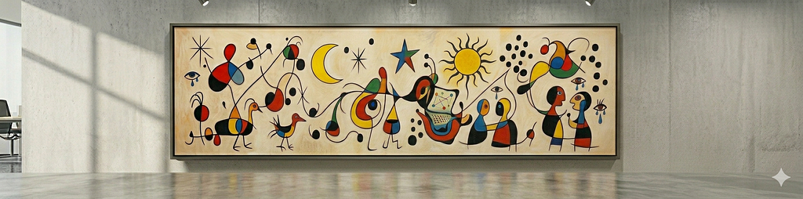

*This post originally appeared on [Medium](https://medium.com/@profjsb/the-implicit-digital-contract-between-people-that-llms-are-disintegrating-b0df1ac37485).*

<figure></figure>

There is a certain kind of tax on human attention that has always existed in digital communication. Spam filters learned to distinguish signals of malicious or mass-generated content from the messages we actually wanted. The massive **one-to-many** asymmetry in that case (one sender, millions of recipients) was so extreme and so obvious that we built thinking machines to fight it on our behalf.

But, thanks to powerful LLMs, that sort of cognitive asymmetry has crept into subtler spaces, and it bothers me in ways I’m still working through.

Consider the dreaded compliance email, the mandatory training, the all-hands directive. An administrator sits down, drafts a message in a few minutes, and with a single send can commandeer the attention of thousands of people, each of whom must now spend an hour watching a training video, clicking through a policy acknowledgment, or completing some required action. Having sat on both sides of that dynamic, I understand the legitimate need for it. And yet, as a recipient, the weight of that asymmetry was always palpable: your few minutes of effort just consumed *thousands* of hours of collective human time. We have largely accepted this as a feature of organizational life, not a bug.

What troubles me now is that a version of this asymmetry has moved into spaces we once assumed was different (perhaps even semi-sacred), territory we treated, at least implicitly, as governed by a different set of rules: **one-to-one** digital communication.

There has always been an unspoken contract in a personal email or a direct message. The implicit agreement was something like: the person on the other end sat down, thought about what they wanted to say to *you specifically*, and invested real cognitive effort in putting it into words. That effort — the selection, the framing, the attempt to capture something accurately and personally — was a kind of gift. And because you understood that it cost them something, you honored it by actually reading what they wrote. You gave it your full attention. That was the deal.

Of course, people have long used spell-check, and more recently, AI assistants to clean up their prose (full disclosure, I used LLMs to clean up THIS post!). That was always understood and mostly fine, because the underlying thought and nuance still originated with the person. The words might have been polished, but the signal and tone was theirs.

What is changing now is something more fundamental. The temptation is to offload not just the polish process but the *generation* itself. A few prompts, a couple of back-and-forths with a beloved language model, and out comes a richly detailed, well-structured, many-paragraph message that appears to have been written with genuine care and effort. The sender paid a *tiny* cognitive cost. The receiver, having no way to know this, **pays the full historical cost of reading carefully, thinking, formulating a response.** The digital contract has been violated invisibly.

To be clear, I am not making an argument against using AI tools. I use them constantly and in fact my new company is helping foster the use of LLMs into research and science. Instead, I am making an argument about what happens to the *implicit agreements* that govern how we relate to each other through digital communication when the effort-signal disappears. This is not merely a philosophical concern. Recent [research out of MIT’s Media Lab found](https://arxiv.org/abs/2506.08872) measurable reductions in brain connectivity and executive function when participants wrote with LLM assistance compared to writing on their own, what the researchers called an accumulation of “cognitive debt.” And a [2025 study](https://www.microsoft.com/en-us/research/wp-content/uploads/2025/01/lee_2025_ai_critical_thinking_survey.pdf) presented found that higher confidence in generative AI is associated with less critical thinking among knowledge workers. The asymmetry isn’t just social, it may also be neurological.

As I build a new organization (called [Valency](http://valency.io)), I have an unusual opportunity and a privilege to help define the culture around this concern somewhat from scratch. While everyone who joins us brings their own norms and habits, and those will inevitably shape what we become, I feel we can also make some deliberate choices together about which digital spaces we want to protect.

My starting position is this: emails between people should be primarily written by people. If you need to synthesize information from several sources, or pull in some structured content that an LLM can help assemble, that seems entirely reasonable: the thought is still yours, and the LLM is helping you communicate it. But if I am reading an email I believe you wrote, I want to know that you actually wrote it. That contract matters to me, and I think it should matter to us collectively. This intuition has empirical backing: a [2025 study](https://www.sciencedaily.com/releases/2025/08/250811104226.htm) found that AI-assisted workplace writing can undermine perceptions of a supervisor’s trustworthiness, with the effect most pronounced in relationship-oriented messages that require empathy and personal judgment. The [damage is invisible to the sender and real for the receiver](https://www.hiig.de/en/unintended-consequences-of-ai-written-emails/).

> If I am reading an email I believe you wrote, I want to know that you actually wrote it. That contract matters to me, and I think it should matter to us collectively.

The same principle applies to Slack, though the specific temptations are a little different. It is very easy now to have a model summarize what a set of pull requests accomplished, or describe what a block of code does, and then paste that summary directly into a channel as if you had written it. A few spoken words, and out comes something that would have taken a thoughtful human engineer several minutes to compose. The receiver has no way to know this, and will read it with the same attention they would give to something you actually spent time on.

My suggestion for cases where you want to share high-information AI-generated content in Slack: take a screenshot and upload it, then write your own summary or commentary in your own words. This preserves the information flow while keeping you, the human, in the loop as the actual author of what your colleagues are reading. It feels like a small friction, but that friction is the point: it is the friction of actually thinking about what you want to say.

I am trying not to be naive about the edges of this. There are clearly parts of our work where the human-to-human contract is already attenuated — documentation that will primarily be read by AI systems, architectural decision records, code and code comments that serve as context for future LLM-assisted work. Those spaces can evolve differently. Part of what I find clarifying about this framing is that it forces us to be explicit: which channels are for humans talking to humans, which are hybrid, and which are primarily for AI consumption? Having those distinctions named and shared across a team seems genuinely useful, regardless of where you draw the lines.

It is worth noting where the asymmetry problem does *not* exist, at least not yet. Face-to-face conversation is essentially symmetric: the effort of speaking and the effort of listening are roughly matched, and the presence of another human body in the room is its own guarantee of authenticity. Zoom calls, even the crappy ones, preserve most of that: you are watching a person think and speak in real time. Phone calls are similar. And I suspect person-to-person text messages — the short, casual, thumbs-on-glass kind — remain relatively safe for now. The friction of composing a text on a cell phone and the intimacy of the channel create enough of a signal that what you’re reading probably came from a person.

But everything else in the digital stack is up for grabs. Email, Slack, PR comments, code review, internal documentation … all of it is now potentially AI-generated, and **none of it comes with a label**. The absence of natural friction means the invisible asymmetry can creep in anywhere we let it.

What I keep coming back to is something harder to articulate but easy to feel: a sense of betrayal when I realize that a digital space I thought was for human-to-human communication has quietly become something else. The intimacy of knowing (or at least believing) that the person on the other side sat down and wrote something specifically for you is not trivial. It is, I would argue, part of **what makes communication feel like communication rather than information transfer**. Preserving some of that, especially as we start something new together, seems worth a little inconvenience.

And when we can be in the same room, we absolute should try to do so. This is, I think, **another and under-appreciated reason why in-person and hybrid work matters more now than ever.** The conversation about remote versus in-person has largely been fought on the grounds of productivity, culture, and serendipitous collaboration. But there is a deeper argument that rarely gets made: face-to-face interaction is one of the last remaining spaces that is structurally immune to this kind of asymmetry. **You cannot prompt your way into a genuine conversation.** You cannot have an LLM attend a meeting on your behalf and pass it off as presence. The effort of showing up, of thinking in real time, of listening and responding in the moment is symmetric by definition. As the digital spaces between us become harder to read and easier to game, the irreducible humanness of being in the same room together becomes not a nice-to-have but something closer to essential.

Curious to get your thoughts.

-Josh  
Berkeley, CA
