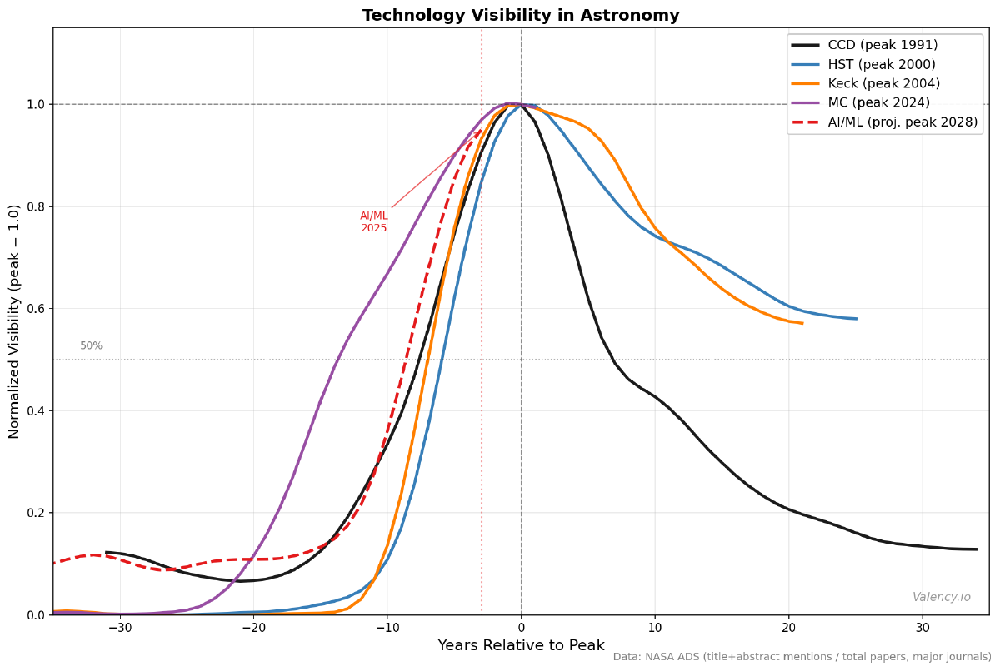
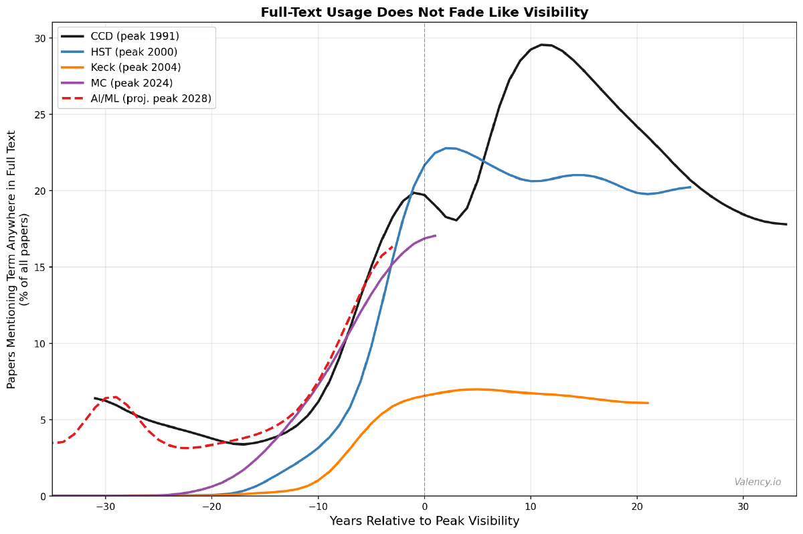

*This post originally appeared on [the Valency Blog](https://blog.valency.io/posts/the-invisible-future-of-ai/).*

Some companies with obscure products, ironically, used to remind us how ubiquitous they were. The **Intel Inside** jingle lives rent free in my head.[^1] The *“We don’t make a lot of the products you buy, we make a lot of the products you buy better”* campaign was remarkably helpful in making [BASF](https://en.wikipedia.org/wiki/BASF) a household name. Now, we’re constantly reminded by just about every company big and small that they have **AI Inside**.

The dot-com naming frenzy was in [Bill Clinton’s presidential address at Caltech in January 2000](https://clintonwhitehouse4.archives.gov/WH/EOP/OSTP/html/0022_5.html).[^2] After enumerating open scientific questions like the nature of black holes and the origin of gamma-ray bursts (a question near and dear to my own heart[^3])—Clinton said: “*And maybe the biggest question of all: How in the wide world can you add $3 billion in market capitalization simply by adding .com to the end of a name?*” (I was in the audience and we laughed, nervously) The naming phenomenon was real and measurable: [Cooper, Dimitrov & Rau (2001)](https://onlinelibrary.wiley.com/doi/10.1111/0022-1082.00408)[^4] documented that companies earned cumulative abnormal returns (~74%) in the days around announcing a dot-com name change—often with no change to the underlying business whatsoever. Today, the *.ai domain boom* is somehow meant to convey that same cachet and gravitas, transcending and elevating the product itself.

As we think about the future of AI in products and science, a natural question emerges: how long does the AI Inside moment actually last? When does a transformative technology stop being a selling point and start being just table stakes? This felt like it might be an empirically answerable question, so I decided to explore.

## Measuring Technology and Tooling Visibility

Using the [NASA Astrophysics Data System (ADS)](https://ui.adsabs.harvard.edu/) and [Valency Bond](https://www.valency.io/bond/), I investigated how often astronomers explicitly name a given technology in their paper titles and abstracts, in the major journals (ApJ, AJ, MNRAS, A&A, PASP), normalized by the total number of papers published each year that mention the term in the body of the paper. Call it *visibility*. I looked at detectors (charge-coupled devices; CCDs), telescope facilities (Keck Telescopes, the Hubble Space Telescope; HST), and methods (Markov Chain Monte Carlo; MCMC). When I aligned these technologies by their peak visibility year and normalized each curve to its own peak, a rather striking pattern emerged:

<figure class="note-figure"><figcaption>Fig. 1 · Technology visibility in astronomy: title/abstract mention rates in the major journals, normalized to each technology’s own peak and aligned at year 0. Data: NASA ADS.</figcaption></figure>

When a technology is novel and exciting, scientists advertise it. A title like “CCD photometry of the globular cluster NGC 6752” ([Penny & Dickens 1986](https://academic.oup.com/mnras/article/220/4/845/989349)[^5] — one of hundreds of papers from the mid-1980s with nearly this exact title) wasn’t just describing a measurement, it was signaling that the authors were using the hot new detector technology. But when a technology becomes infrastructure, the explicit naming stops. Figure 1 shows this effect across many types of technology.

This visibility metric is meant to avoid technologies that simply fall out of favor. Indeed on the same peak-aligned time axis, the fraction of *all* papers mentioning each term *anywhere* in the full text stays essentially flat after the visibility peak. So these technologies moved from the abstract to the methods section, not actually falling into disuse.

<figure class="note-figure"><figcaption>Fig. 2 · Full-text mentions, peak-aligned: the fraction of <em>all</em> papers mentioning each term anywhere in the full text stays essentially flat after title/abstract visibility peaks.</figcaption></figure>

## Unpacking the CCD Visibility Story

The charge-coupled device ([invented at Bell Labs in 1969](https://en.wikipedia.org/wiki/Charge-coupled_device)[^6]; on telescopes by the late 1970s) utterly revolutionized astronomy. Before CCDs, we exposed photographic plates and squinted at grains. CCDs were digital, linear, and quantitative and were a genuine paradigm shift in how we collect photons and do science.

In 1991, “CCD” appeared in nearly 10% of all astronomy paper titles and abstracts. One in ten papers in the entire field felt compelled to mention the detector. Astronomers highlighted the technology because it *mattered* that they were using it.

CCDs (and their CMOS descendants) are now the main detectors in virtually every optical instrument on Earth and in space, and the term appears in barely 1% of abstracts — about 13% of its peak visibility. The technology didn’t go away. Quite the opposite: it became so ubiquitous that naming it became redundant. When everything is CCD photometry and spectroscopy, nothing is.

The sociologist Bruno Latour talked about *black-boxing* as “*the way scientific and technical work is made invisible by its own success*” ([Pandora’s Hope](https://www.hup.harvard.edu/books/9780674653368), 1999).[^7] When a machine runs efficiently, we attend only to its inputs and outputs, not its internal complexity. The more science and technology succeed, the more opaque they become. What I find here is that we can *watch this happen quantitatively*: a rise, a peak, and a long, slow fade into assumed invisibility.

## So Where is AI on This Curve?

Looking at the red dashed line in figure 1 we see AI/ML in astronomy — machine learning, neural networks, and deep learning, bucketed together. It’s still climbing, and, if you squint, perhaps nearly a plateau (peak that arrives around 2028?).

Right now, we write titles like “[A recurrent neural network for classification of unevenly sampled variable stars](https://ui.adsabs.harvard.edu/abs/2018NatAs...2..151N/abstract)” ([Naul et al. 2018](https://ui.adsabs.harvard.edu/abs/2018NatAs...2..151N/abstract)[^8]) or “[Real-bogus classification for the Zwicky Transient Facility using deep learning](https://arxiv.org/abs/1907.11259)” ([Duev et al. 2019](https://arxiv.org/abs/1907.11259)[^9] — work I’m proud to have been a part of). The method is in the title because the method is still the point. It signals sophistication and it’s a real differentiator.

MCMC, the workhorse Bayesian sampling technique, appears to have *just* peaked (2024, by my reckoning) and is beginning exactly the descent that CCD began in 1991. Methods, like detectors, also apparently get absorbed. If AI/ML follows the trajectory of every other transformative technology in this analysis — CCDs, HST, Keck, MCMC — then within a decade or two, titles of scientific papers will focus on the outcomes and insights, not the pathway to get there. AI will be inside, but it won’t be novel.

## The Paradox of Success

This, it seems, is the paradox at the heart of every transformative technology: the more successful it becomes, the less visible it is. The AI Inside moment is, by its very nature, temporary. Intel still puts chips in most of the world’s computers but who notices the sticker anymore?

For the companies currently festooning their products with AI ✨ emojis: the branding window is finite. For scientists, this curve is something closer to a prediction: we’re perhaps three years from peak AI visibility in the astronomical literature.

And for those of us thinking about the long arc of AI + science, I take this as a genuinely optimistic result. Paradigm shifts don’t end with a bang; they end with a slow fade into infrastructure. AI-accelerated science will just be called science.

---

*Visibility metric: fraction of papers mentioning a term in title or abstract, per year, normalized by papers mentioning the term anywhere in the full text, in ApJ, AJ, MNRAS, A&A, and PASP (1960–2025), via the NASA ADS API. AI/ML bucket: “machine learning” OR “neural network” OR “deep learning”. MC bucket includes MCMC and Markov Chain Monte Carlo variants. Peaks for AI/ML are projected; all others are observed.*

[^1]: On the Intel Inside campaign: [Intel’s own history](https://www.intel.com/content/www/us/en/history/virtual-vault/articles/end-user-marketing-intel-inside.html)

[^2]: Clinton, W.J. (2000). Remarks at Science and Technology Event, California Institute of Technology, January 21, 2000. [Clinton White House archives](https://clintonwhitehouse4.archives.gov/WH/EOP/OSTP/html/0022_5.html)

[^3]: Bloom, Joshua S. (2011) [What are Gamma Ray Bursts?](https://press.princeton.edu/books/paperback/9780691145570/what-are-gamma-ray-bursts?srsltid=AfmBOop_HSIph_1ji3VJh2t-uolHWgzf-KPNqok8aYLv6OPHB4k1M4Jy)

[^4]: Cooper, M.J., Dimitrov, O. & Rau, P.R. (2001). “A Rose.com by Any Other Name.” *The Journal of Finance*, 56, 2371–2388. [DOI:10.1111/0022-1082.00408](https://onlinelibrary.wiley.com/doi/10.1111/0022-1082.00408)

[^5]: Penny, A.J. & Dickens, R.J. (1986). “CCD photometry of the globular cluster NGC 6752.” *MNRAS*, 220, 845. [DOI:10.1093/mnras/220.4.845](https://academic.oup.com/mnras/article/220/4/845/989349)

[^6]: Boyle, W.S. & Smith, G.E. (1970). “Charge Coupled Semiconductor Devices.” *Bell System Technical Journal*, 49, 587.

[^7]: Latour, B. (1999). *Pandora’s Hope: Essays on the Reality of Science Studies*. Harvard University Press. See also *Science in Action* (1987).

[^8]: Naul, B., Bloom, J. S., Pérez, F., and van der Walt, S., “A recurrent neural network for classification of unevenly sampled variable stars”, *Nature Astronomy*, vol. 2, pp. 151–155, 2018. [doi:10.1038/s41550-017-0321-z](https://www.nature.com/articles/s41550-017-0321-z).

[^9]: Duev, D.A., et al. (2019). “Real-bogus classification for the Zwicky Transient Facility using deep learning.” *MNRAS*, 489, 3582. [arXiv:1907.11259](https://arxiv.org/abs/1907.11259)
