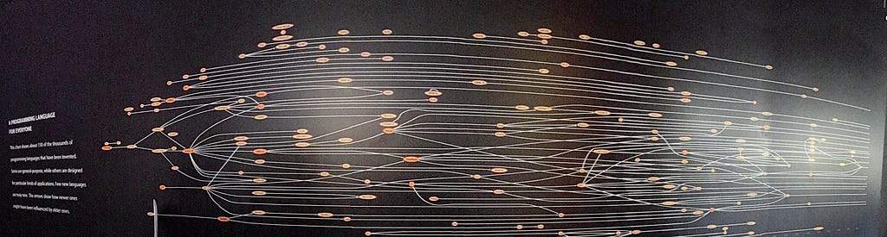

*This post originally appeared on [Medium](https://medium.com/@profjsb/the-last-programming-languages-created-by-people-6aef63e310b7).*

For many of those in the tech and science worlds, it’s hard not to feel we are living through an inflection moment. I recently wrote about [my early **vibe sciencing** foray](https://medium.com/@profjsb/mis-adventures-of-genai-in-the-scientific-workflow-d2ff1d804850). Indeed, GenAI is fostering change across all our workflows: how we code and deploy, the speed of creation, the breadth of any one person’s capabilities, the extent and ease of testing, etc. Even the stalwarts of the pre-AI era are embracing new tooling. Case in point, [Linus Torvalds](https://en.wikipedia.org/wiki/Linus_Torvalds) is now [vibe coding](https://arstechnica.com/ai/2026/01/hobby-github-repo-shows-linus-torvalds-vibe-codes-sometimes/). It’s not quite as dramatic as pigs flying, but it’s heading that way.

Another harbinger-of-things-to-come moment happened today, when Wes McKinney (creator of [Pandas](https://pandas.pydata.org/) and [Apache Arrow](https://arrow.apache.org/)) [penned a remarkable insight](https://wesmckinney.com/blog/agent-ergonomics/) following his vibe coding experiences of the past few months. It’s worth a read but the summary is that, apart from human-in-the-loop data science workflows, he now believes that Python is the wrong language of choice for just about every part of the stack where it used to be a good choice. The main reason: the beauty of human-readable and expressive Python is no longer an acceptable tradeoff for the execution overhead of the language. If agents are doing all the coding and reviewing, it is *time to create* and *efficiency in production* that become the primary optimization metrics. On this front, Go (and maybe Rust) appear to be clear winners for vibe coding — assuming, of course, they are expressive enough with their library ecosystems. **Let’s let that sit for a minute: a major figure in the Python world is saying Python is no longer the right substrate for this new era.**

> “Human ergonomics in programming languages matters much less now.” — [McKinney](https://wesmckinney.com/blog/agent-ergonomics/)

What does a world look like where the best and brightest stop hand-crafting artisanal code? For one, the economics of open-source software morphs as AI agents become the leading consumers of work. Marc Schmidt’s [recent post](https://www.linkedin.com/posts/marc-j-schmidt-957875110_all-my-new-code-will-be-closed-source-from-activity-7415115103953477632-rahG/?utm_medium=ios_app&rcm=ACoAAAF3UKEBCDq6DQl1vmrcongJ8pkMJI1U83g&utm_source=social_share_send&utm_campaign=copy_link) portends a phase transition, one where the attention economy of open source inverts entirely: “*No humans will ever read my docs again when coding agents do it in seconds. Nobody will even know it’s me who built it…Your docs trained the models that now make visiting you unnecessary. Human attention paid. Artificial attention doesn’t.*”

<figure><figcaption>“A Programming Language for Everyone” — Perhaps my favorite <a href="https://www.computerhistory.org/revolution/the-art-of-programming/9/357/2216">exhibit</a> at the <a href="https://computerhistory.org/">Computer History Museum</a>. Does the family tree of programming languages die off in the era of GenAI? (Photo shown here was taken by me on August 27, 2025 — I don’t know who the original creator of this poster is.)</figcaption></figure>

We humans developed new languages in concert with the advent of new use cases and faster and different hardware. Old languages, obviated by better ones, were killed off through a kind of natural selection. New ones were made (mostly) continually better by flourishing communities dedicated to improvement, borrowing and stealing from the best of other languages. Most of it happened out in the open and all of it was done by people who cared.

Agents that build software are trained on approximately all the software that has been written by humans in the past. And so if agents are to build software in the future it would stand to reason that at least in the short term, they will do so in the languages they know. So I wonder, if humans aren’t going to code any longer, what incentives does anyone have to create a new language primarily for humans to code in? How could a new language even have a chance to be embraced by people, improved, and then flourish? *Are Python, Go, and Rust the last human-created programming languages?*

This is not to say there won’t be new languages and protocols in the future, especially as specialized hardware is brought to market and the current suite of languages are matched inefficiently to the new capabilities. Indeed, AI agents will be incentivized to optimize to create programming abstractions that are easy to reason over, far from bare metal instruction sets. But there will be little incentive for those new alien languages to be understandable, let alone parseable, by us people.

Programming languages have always been tools for humans to think about computation, not just make computers do our bidding. Even in an era where agents do all the coding, we might still want readable languages for auditing and teaching. But those niche uses won’t generate the community energy — the thousands of contributors, the blog posts, the [Stack Overflow answers](https://blog.pragmaticengineer.com/stack-overflow-is-almost-dead/) — needed to birth and nurture a new language into maturity. More likely, we’ll just keep using the old ones. Just as some intro CS classes still teach C decades after it ceded the mainstream, we might be teaching the ancient art of programming in Python a century from now.

I’m curious to get your thoughts.
