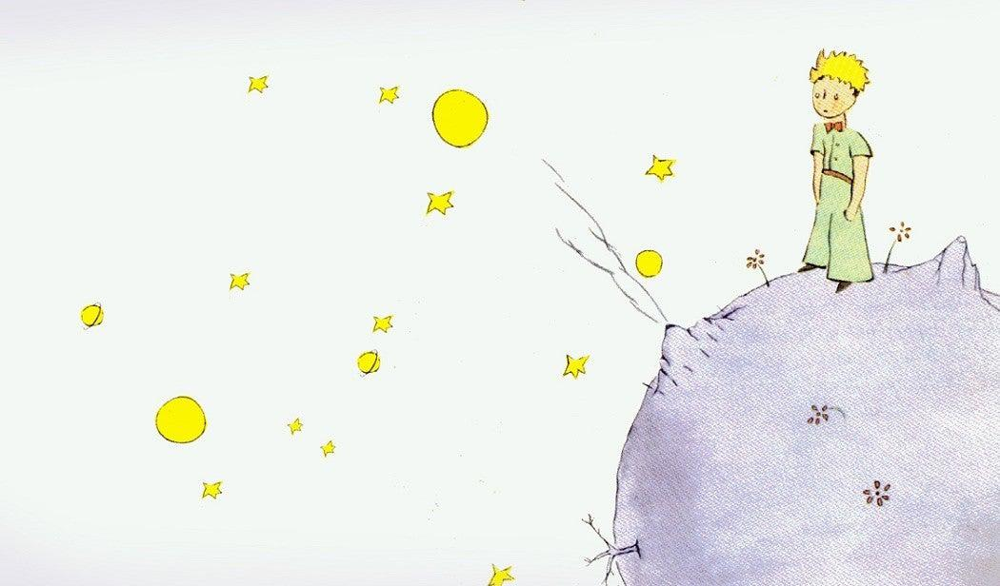

*This post originally appeared on [the Valency Blog](https://blog.valency.io/posts/we-need-more-scientists/).*

Labor displacement concerns with new technology are neither new nor entirely unfounded. The Luddites, pegged by history as railing against new machinery, were in essence a labor movement[^1]. Telephone switchboard operators dwindled rapidly following electromechanical switching investments[^2]. In a recent essay, Bill Gates called for policy intervention to stem the wholesale move from human labor to machines: “*AI will take on work in law, customer service, medicine, software, and manufacturing… There will be some new jobs, but without the right policies, there will be far fewer than exist today.*”[^3]

Now, as AI becomes more enmeshed not just in our daily lives but in our scientific work, and looking back on such historical labor displacements, there is a growing unease among scientists, and especially among budding scientists. **What will be the role of scientists when increasingly capable AI co-scientists[^4] can participate in precisely the sort of labor we have trained (or are training) to do?**

Attitudes towards AI in science were captured in a survey of scientists in 2023 (which feels like many generations ago now)[^5]. While most saw AI assisting with faster data processing and computation, many worried about entrenched bias, easier fraud, and superficial understanding — labor displacement concerns weren’t at the fore, but clearly on the horizon. Fast forward to 2026, as AI co-scientists have become demonstrably better, astronomer David Hogg’s white paper “[Why do we do astrophysics?](https://arxiv.org/abs/2602.10181)” identifies two diametrically opposed future paths: one where AI is kept at bay, and one where it sweeps through our profession and relegates scientists to observers, rather than owners, of the scientific process. And Terence Tao, in a recent ICM lecture capturing the transformative moment for AI in mathematics, argues that the real crisis is not machine capability but values: AI can accelerate proof and verification, and it falls to the community — not the technology companies — to decide what mathematical work is actually for[^6].

My own optimism here, not just as a scientist but as an educator and builder of [tools for AI-accelerated science](https://www.valency.io/bond/), stems from a belief that establishing our work as a zero-sum in the number of jobs to be done (i.e. that there is a fixed amount of scientific labor needed per unit time) is not the right framing. Instead, I see science work happening inside of a rapidly growing pie with increasingly more room for both scientists and their silicon sidekicks.

## The geometry of the frontier of science

A useful metaphor perhaps is the Little Prince, who saw dozens of sunsets in a single day, less out of wonder than because his world was small enough that a chair was all it took to see them all[^7]. That is what a finished world feels like from the inside. Place him on Pluto (with appropriate outerwear!) or on the surface of the Earth, and with the same stride and appetite, he would meet wonders that couldn’t be grokked in a million lifetimes. What changed is the size of the thing he’s standing on. That position was once ours: when the first scientific journals appeared in 1665, a diligent person could read all of it[^8]. And the most famous claim from ~1900 that scientific growth had stopped — physics is finished, nothing left but decimal places — is an apocryphal prediction that has comically been proven wrong over and over[^9].

<figure class="note-figure"><figcaption>Fig. 1 · As AI helps us push the frontiers, there will be much more volume to explore and discover. Illustration by Antoine de Saint-Exupéry, from <em>The Little Prince</em> (1943). Image via <a href="https://daily.jstor.org/flight-antoine-de-saint-exupery/">JSTOR Daily</a>, where it accompanies Crim, K. (2009). “Flight.” <em>The Threepenny Review</em>, No. 117, pp. 8–9.</figcaption></figure>

So if we think of the sum total output of scholarly work from a single scientist over the course of their career as filling some volume of knowledge, then we could view AI co-scientists as encroaching on, and perhaps entirely crowding out, that future volume coverage. In a *fixed* volume, that’s correct. But tools and innovation push the radius out. For a ball of radius *r* in *D* dimensions \(dV/dr = D\,V/r\). The fractional return on pushing the frontier out — new volume per new radius — isn’t a constant. It **is** *D*. And *D* is not small in the sciences (it’s certainly not 2, in the case of pie). If the use of such AI-enabled tools grows the radius, it should (or maybe must?) expand the volume faster than the machines can fill the space.

The central supposition of Gates’ argument of a coming wave of job loss is that there is a fixed amount of effort to be done. And that may well be right for most of the economy: demand for labor is ultimately bounded by the population it serves. While there is certainly much headroom here, I can see how a fixed number of people in the world ultimately becomes a cap, abstractly, on the volume of work to be done (i.e. zero sum). In contrast, the frontiers of knowledge in science are unbounded, and so my hope is that that implicit argument from Gates (and those many before him) does not apply.

## A Scientist’s Central Role

As the search and discovery volume increases and AI helps us grow and explore the space, there are parts of the scientist’s role that become very central:

1. **Choosing the question.** Which direction to push the radius. No amount of volume-filling substitutes for picking a direction worth walking in.
2. **Knowing when a result is too good.** The skeptic in all of us when confronted with new results gets *more* valuable, not less, as the volume of plausible-looking output goes up.
3. **Taking ownership.** Accountability scales with people, not with compute.

In this light — as the frontiers of knowledge are pushed outward with ever-more sophisticated tooling, inexorably, I’d argue — we need more scientists, not fewer. It’s still very early innings for AI-accelerated science, and if the volume-expansion analogy holds, the shell at the frontier we’re all standing on is about to get a great deal roomier. I couldn’t be more excited about who gets to go play in it.

The conduct of science is not zero-sum.

[^1]: Hobsbawm, E. J. (1952). “The Machine Breakers.” *Past & Present*, 1(1), 57–70. [DOI:10.1093/past/1.1.57](https://doi.org/10.1093/past/1.1.57). See also Conniff, R. (2011). “[What the Luddites Really Fought Against](https://www.smithsonianmag.com/history/what-the-luddites-really-fought-against-264412/).” *Smithsonian Magazine*, March 2011.

[^2]: Feigenbaum, J. J. & Gross, D. P. (2024). “Answering the Call of Automation: How the Labor Market Adjusted to Mechanizing Telephone Operation.” *Quarterly Journal of Economics*, 139(3), 1879–1939. [DOI:10.1093/qje/qjae005](https://academic.oup.com/qje/article-abstract/139/3/1879/7614605); ungated as [NBER Working Paper 28061](https://www.nber.org/papers/w28061).

[^3]: Gates, B. (2026). “A Turbulent AI Era and Critical Choices to Make.” *GatesNotes*, 26 August 2026. [gatesnotes.com](https://www.gatesnotes.com/a-turbulent-ai-era-and-critical-choices-to-make); coverage at [CBS News](https://www.cbsnews.com/news/bill-gates-ai-jobs-warning/) and [CNBC](https://www.cnbc.com/2026/08/26/bill-gates-ai-jobs-economic-upheaval.html).

[^4]: Gottweis, J., Weng, W.-H., Daryin, A., et al. (2026). “Accelerating scientific discovery with Co-Scientist.” *Nature*, 655, 487–496. [DOI:10.1038/s41586-026-10644-y](https://www.nature.com/articles/s41586-026-10644-y). Ghareeb, A., Chang, B., Mitchener, L., et al. (2026). “A multi-agent system for automating scientific discovery.” *Nature*, 655, 497–505. [DOI:10.1038/s41586-026-10652-y](https://www.nature.com/articles/s41586-026-10652-y)

[^5]: Van Noorden, R. & Perkel, J. M. (2023). “AI and science: what 1,600 researchers think.” *Nature*, 621, 672–675. [DOI:10.1038/d41586-023-02980-0](https://www.nature.com/articles/d41586-023-02980-0)

[^6]: Tao, T. (2026). “Mathematics in the Age of AI.” Public lecture, International Congress of Mathematicians, 24 July 2026. Essay: [arXiv:2608.16753](https://arxiv.org/abs/2608.16753); [recording](https://www.youtube.com/watch?v=M0--ZH1lOzg).

[^7]: Saint-Exupéry, A. de (1943). *Le Petit Prince*. Reynal & Hitchcock. The sunsets are in ch. VI — forty-three in the French, forty-four in Katherine Woods’ 1943 English translation.

[^8]: Banks, D. (2017). *The Birth of the Academic Article: Le Journal des Sçavans and the Philosophical Transactions, 1665–1700*. Equinox Publishing.

[^9]: Kelvin’s actual 1900 lecture: Thomson, W. (Lord Kelvin) (1901). “Nineteenth-Century Clouds over the Dynamical Theory of Heat and Light.” *Philosophical Magazine*, Series 6, 2(7), 1–40. [DOI:10.1080/14786440109462664](https://doi.org/10.1080/14786440109462664). The “sixth place of decimals” remark is Michelson’s: Michelson, A. A. (1903). *Light Waves and Their Uses*. University of Chicago Press, pp. 23–24. [Full text at archive.org](https://archive.org/details/lightwavestheiru00mich).
